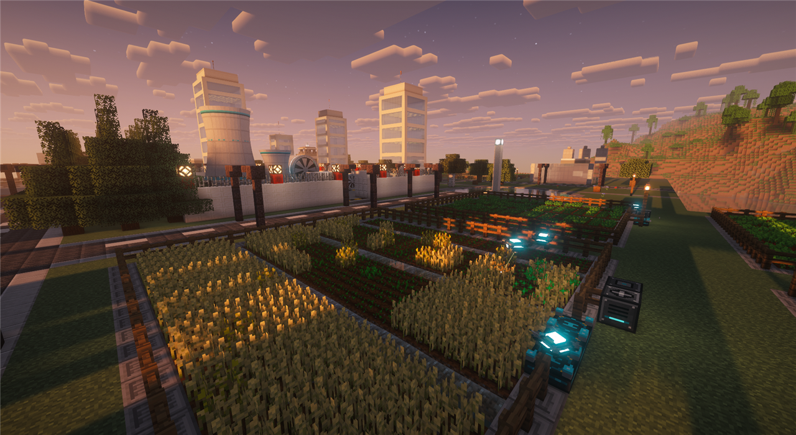
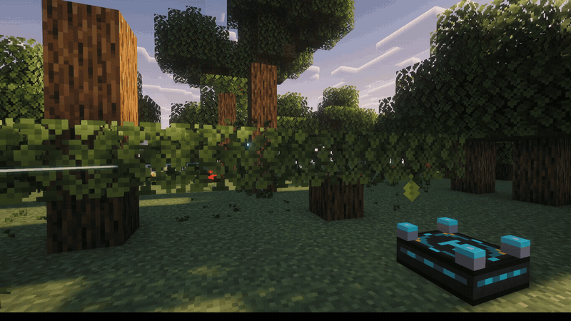
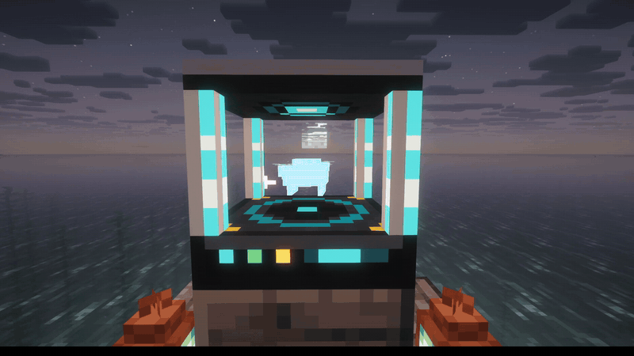
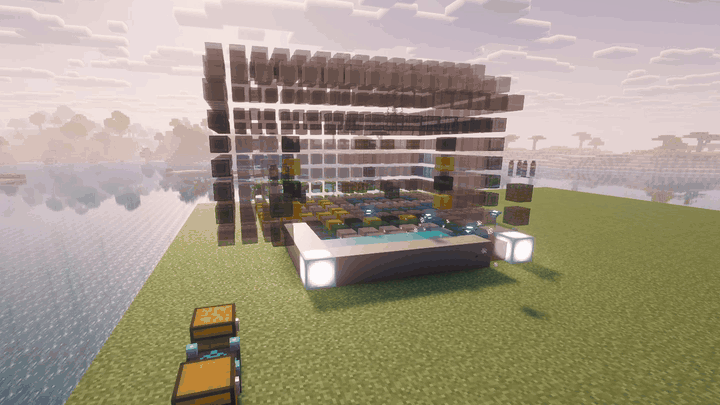
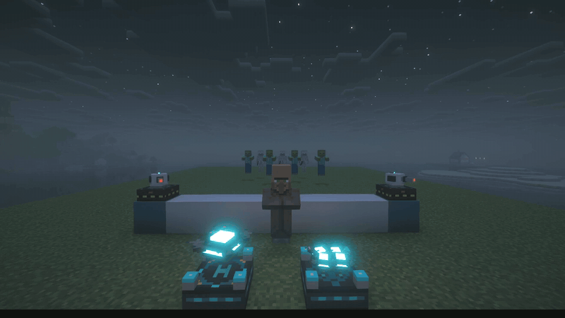
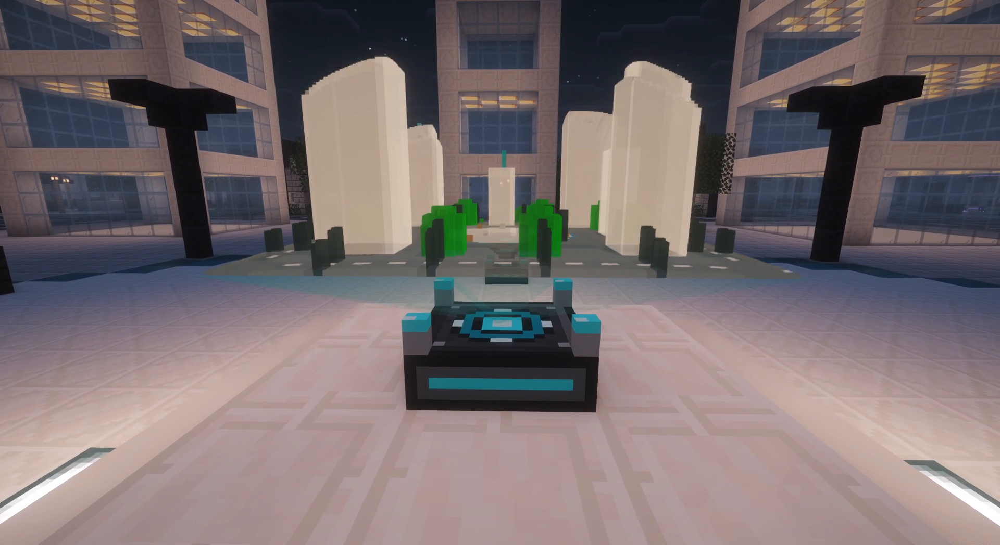
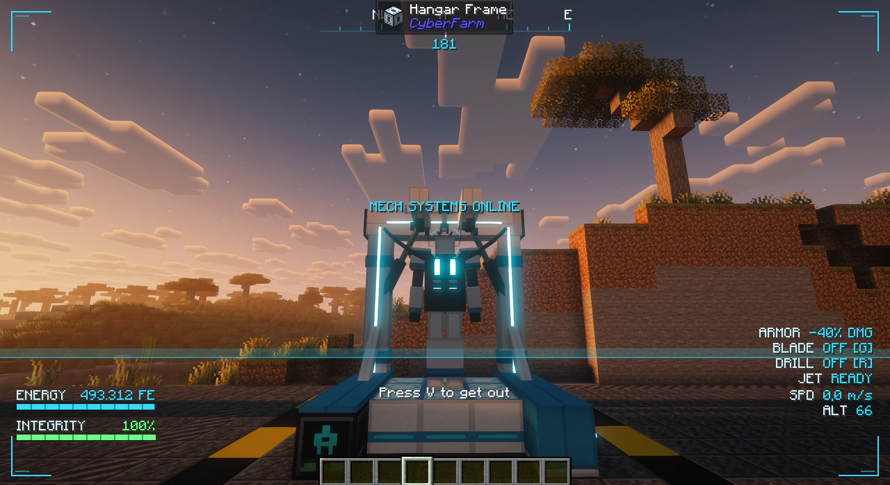

# CyberFarm



**CyberFarm** is a tech mod for **Minecraft 26.1.2 (NeoForge)** about modular drones that run your
farms, the power plants that keep them flying and, at the end of it all, a mech you pilot yourself.
It starts with a combustion generator and a first drone, and grows through biogas, methane and
steam up to a nuclear reactor with its own cooling tower. Clean white-and-cyan sci-fi style, FE
power, and machines you can watch at work.

Everything is explained in game by the **Drone Engineer's Handbook**, given to every player on their
first login, and the **CyberFarm advancement tab** (press **L**) shows where to go next.

## What's new

**0.7.0: logistics and materials**
- A three-tier **material progression** with the materials of real drones: **bauxite** and
  **aluminum**, **carbon fiber**, and **Basic, Advanced and Elite Circuits**, made in three new
  machines: the **Electrolyzer**, the **Pyrolysis Oven** and the **Fabricator**.
- **Transport limit**: a Transport drone can stop once its destination holds enough of an item.
- **Anchor Addon**: a drone's dock keeps its chunks loaded, paying FE for each one.

**0.6.0: a mod you can watch**
- The **Hologram Table**: a live 3D map of your base with every dock and drone on it.
- **Look at any machine** to see what it is doing: working or idle, FE made and used, progress.
- Machines **light up and animate** while they work, their lights glow at night, and the small ones
  have moving parts: a turbine fan, a pump piston, a digester paddle.
- Builder drones **print** blocks into place, multiblocks **reveal** themselves with a ring of
  light, and the new **open Drone Assembler** shows the drone taking shape inside it.
- Drones hit their work with a beam of light, kick up dust flying low and crackle with energy on
  their docks; machine screens are animated too.
- The **CyberFarm advancement tab**.

**0.5.0: drones that build**
- **Builder** drones, **schematics** in the Multiblock Projector, the **Builder Swarm Dock** with
  four **Mini Drones**, and the **Fisher** and **Breeder** modules.

## Drones



A drone is put together in the **Drone Assembler** from three kinds of parts:

- a **frame** in three tiers (Basic, Advanced, Elite) that sets its battery, speed and room for
  modules and addons; or the half-size **Mini Frame**, four of which share a **Builder Swarm Dock**;
- **function modules**, which decide its job:
  **Harvester** (crops), **Quarry** (digs a whole area down to bedrock), **Transport** (from one
  storage to another, of any mod), **Planter**, **Logger** (fells whole trees and replants),
  **Rancher** (shears and milks), **Fertilizer**, **Fisher** (vanilla fishing loot, treasure
  included), **Breeder**, **Taxi** (carries you, hanging from its hook) and **Builder**;
- **addons**: Speed, Stack, Battery, Fortune, Silk Touch and Anchor.




Every drone lives on a **Drone Dock**, which charges it and stores what it brings back. The
**Survey Tool** marks its work area, its transport route or its taxi destination, and the dock's
item filter decides what it keeps. There is no programming: an area and a dock are all a drone needs.

**Building with drones.** The **Multiblock Projector** shows any CyberFarm multiblock, or a
schematic, as ghost blocks. Lock it in place, link it to a dock, and its Builder drones raise it
layer by layer with the blocks you put in the dock. Three ready-made buildings come with the mod,
and any data pack can add more.



**Defending it.** **Laser Turrets** shoot the hostile mobs they see, a **Guard** drone hunts them
over its work area and a Mini Drone with the **Bomb** module dives at them.



**Watching your base.** The **Hologram Table** projects the land around it in relief, with your
docks as pillars of light, your drones moving live with their trails, players as arrows and hostile
mobs as red dots. Right-click it to zoom between 16, 24 and 32 blocks.



## Materials and progression

| Tier | Materials | Made in | Unlocks |
| --- | --- | --- | --- |
| **1** | Aluminum, Basic Circuits | Electrolyzer, crafting table, Fabricator | First frames, modules, docks and machines |
| **2** | Carbon Fiber, Advanced Circuits | Pyrolysis Oven (methane), Fabricator (acid) | Advanced frames and the mid-game machines |
| **3** | Elite Circuits | Fabricator (acid and uranium) | Elite frames, the reactor, the turbine and the mech |

Bauxite is found in the Overworld; each tier needs the power and chemistry of the one before it.

## Power

Power is **FE**, so CyberFarm machines work with the generators, cables and batteries of other mods.

1. **Combustion Generator**: burns furnace fuel.
2. **Gas**: the **Bio-Digester** turns compost into biogas, the **Methane Extractor** (a 3x3x4 acid
   chamber you lead mobs into) collects methane, and the **Gas Turbine** burns both.
3. **Steam Engine**: a boiler, one to four cylinders with their pistons pumping and a dynamo with a
   spinning flywheel, built in a row.
4. **Nuclear**: uranium, **Fuel Rods** and a **Fission Reactor** shaped like a real cooling tower in
   three sizes. Its heat boils water into steam for a multiblock **Steam Turbine** with a spinning
   rotor. Push it too hard and it melts down.

The nuclear tier brings real risks and the tools to handle them: **Coolant** and **Cryo Coolant**,
radioactive waste treated in the **Waste Reprocessor**, chunk radiation and Radiation Sickness, the
**Hazmat Suit** and the **Geiger Counter**.

**Storing it.** The **Resonance Core** is a buildable battery: a floating crystal held steady by
the beams of **Stabilizer Pylons**, growing with a shell of **Resonance Cells** through four tiers,
up to 2 billion FE.

## The Mech

The end game: a pilotable mech about three and a half blocks tall. You step into the bay in its
trunk, the front closes around you like a flower, and you walk, jump and punch with it, with a
cockpit display instead of your hearts and hunger. A **Mech Hangar** unfolds it, parks it and fits
its four modules with a gantry arm: a **Jet** to fly, a **Drill** that digs 3x3, a glowing
**Blade** and **Armor** plating. Its heart, the **Mech Core**, is built around a Fusion Crystal
grown in the **Crystallizer** from reactor waste.



## Cables and tanks


**Energy Conduits**, **Gas Pipes** and **Liquid Pipes**, each in three tiers, connect by themselves
to blocks of any mod. Right-click a cable's arm to pull out of a battery, tank or machine. **Liquid
Tanks** and **Gas Tanks** store 32 buckets and show the fluid inside through their windows, and a
**Water Pump** gives an endless water supply.

## Compatibility

- **JEI** and **REI**: recipe pages for every machine, drone assembly and info pages.
- Fluids, items and energy use the standard NeoForge capabilities and common `c:` tags (aluminum is
  `c:ingots/aluminum`), so pipes, tanks and machines of other mods work with CyberFarm's and the
  other way round.
- A **Muffler** silences machines, drones and mobs around it.

## Requirements

| | Version |
| --- | --- |
| Minecraft | 26.1.2 |
| NeoForge | 26.1.2.122 or newer |
| Java | 25 |
| [GuideME](https://www.curseforge.com/minecraft/mc-mods/guideme) | optional, for the in-game handbook |
| JEI or REI | optional, for recipe pages |

## Installation

Download `cyberfarm-<version>.jar` from the [releases](https://github.com/Gianni1707/cyberfarm/releases)
and put it in the `mods` folder of a NeoForge 26.1.2 instance, plus GuideME for the handbook. It is
needed on both the server and the client.

## Building from source

```bash
./gradlew build
```

The jar ends up in `build/libs/`. `./gradlew runClient` starts a development client; set
`recipe_viewer=jei` or `rei` in `gradle.properties` to choose the recipe viewer loaded with it.
Textures and models are generated by `tools/texgen.py` and `tools/assetgen.py`, the schematics by
`tools/schemgen.py` and the drone's flight sound by `tools/soundgen.py`.

## Made with Claude

CyberFarm is made with the help of **Claude**, Anthropic's AI, through Claude Code: the code, the
models and textures, the sounds and the handbook were written together with it, while the ideas,
the design choices and every in-game test are mine.

## License

MIT.
