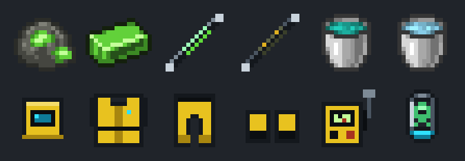
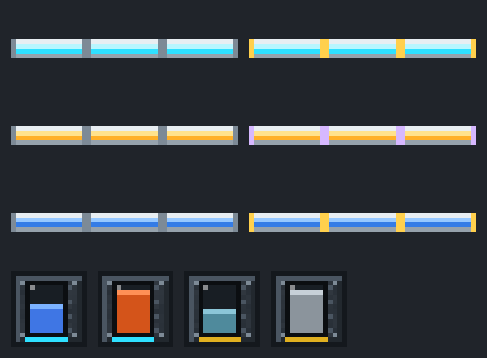

# CyberFarm


**CyberFarm** is a tech mod for **Minecraft 26.1.2 (NeoForge)** about modular drones that run your
farms, and the power plants that keep them flying: from a simple combustion generator to biogas,
methane and, at the end, a nuclear reactor with its own cooling tower. Clean sci-fi style, FE power
and compatible with other tech mods.

Everything is explained in game by the **Drone Engineer's Handbook**, given to every player on their
first login.

## Drones


A drone is built in the **Drone Assembler** from three kinds of parts:

- a **frame** in three tiers (Basic, Advanced, Elite): battery, speed, how many modules and addons it takes;
  or the half-size **Mini Frame**, four of which share a **Builder Swarm Dock**;
- one to three **function modules**, which decide its job:
  **Harvester** (crops), **Quarry** (digs a whole area down to bedrock), **Transport** (chest to chest),
  **Planter**, **Logger** (fells whole trees and replants), **Rancher** (shears and milks animals),
  **Fertilizer** (any fertilizer, modded ones too), **Taxi** (carries you, hanging from its hook) and
  **Builder** (builds the multiblock or schematic you lock with the Multiblock Projector);
- **addons**: Speed, Stack, Battery, Fortune and Silk Touch.

Every drone lives on a **Drone Dock**, which charges it and stores what it brings back. The
**Survey Tool** marks its work area, its transport route or its taxi destination. The dock has an
item filter for the Quarry and Transport modules, and drones can be taken apart again to change
their parts.

## Power


Power is **FE**, so CyberFarm machines work with generators, cables and batteries of other mods.

1. **Combustion Generator**: burns furnace fuel.
2. **Gas power**: the **Bio-Digester** turns compost into biogas, the **Methane Extractor** (a 3x3x4
   chamber you lead mobs into with a **Mob Capsule**) collects methane, and the **Gas Turbine** burns both.
3. **Nuclear power**: uranium, **Fuel Rods** and a **Fission Reactor** shaped like a real cooling tower
   in three sizes. The heat boils water into steam for a multiblock **Steam Turbine** with a spinning
   rotor. Push it too hard and it melts down.



The nuclear tier comes with real risks and the tools to handle them: **Coolant** and **Cryo Coolant**
from the **Coolant Mixer**, radioactive waste treated in the **Waste Reprocessor**, chunk radiation and
Radiation Sickness, the **Hazmat Suit** and the **Geiger Counter**. A **Multiblock Projector** shows
the structures as ghost blocks while you build them.

## Cables and tanks



**Energy Conduits**, **Gas Pipes** and **Liquid Pipes**, each in three tiers, connect by themselves to
blocks of any mod. Right-click a cable's arm to pull out of a battery, tank or machine. **Liquid
Tanks** and **Gas Tanks** store 32 buckets and show the fluid inside through their windows. A
**Water Pump** gives an endless water supply.

## Compatibility

- **JEI** and **REI**: recipe pages for every machine (what it takes, what it makes and its numbers),
  drone assembly and info pages.
- Fluids, items and energy use the standard NeoForge capabilities and common `c:` tags, so pipes,
  tanks and machines of other mods work with CyberFarm's and the other way round.
- A **Muffler** silences machines, drones and mobs around it.

## Requirements

| | Version |
| --- | --- |
| Minecraft | 26.1.2 |
| NeoForge | 26.1.2.122 or newer |
| Java | 25 |
| [GuideME](https://www.curseforge.com/minecraft/mc-mods/guideme) | optional, for the in-game handbook |
| JEI or REI | optional, for recipe pages |

## Installation

Put `cyberfarm-<version>.jar` in the `mods` folder of a NeoForge 26.1.2 instance, plus GuideME for
the handbook. It is needed on both the server and the client.

## Building from source

```bash
./gradlew build
```

The jar ends up in `build/libs/`. `./gradlew runClient` starts a development client; set
`recipe_viewer=jei` or `rei` in `gradle.properties` to choose the recipe viewer loaded with it.
Textures and models are generated by `tools/texgen.py` and `tools/assetgen.py`, the drone's flight sound by
`tools/soundgen.py`.

## License

All rights reserved.
