# CyberFarm

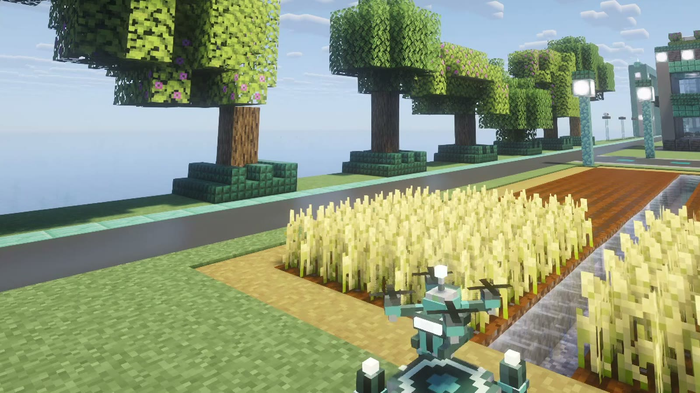

**CyberFarm** is a tech mod for **Minecraft 26.2, 26.1.2 and 1.20.1** (NeoForge, and Forge on 1.20.1)
about modular drones that run your farms, the power plants that keep them flying and, at the end of it all, a mech you pilot yourself.
It starts with a combustion generator and a first drone, and grows through biomass, biogas, methane and
steam up to a nuclear reactor with its own cooling tower. Everything is built in dark teal, mint and
steel: every machine is a 3D model that assembles, opens up, lights and moves while it works, and
every pipe and cable shows what flows through it. Power is FE.

Everything is explained in game by the **Drone Engineer's Handbook**, given to every player on their
first login, and the **CyberFarm advancement tab** (press **L**) shows where to go next.

## What's new

**1.0: the restyle**
- **A new look for everything**: a dark teal, mint and steel palette, a smaller farm drone whose tools
  move as they work, and every machine redrawn as an animated 3D model.
- **Machines that assemble**: the Biomass Press, Bio-Digester, Fabricator, Acid Synthesizer,
  Electrolyzer, Pyrolysis Oven, Coolant Mixer, Gas Turbine, Steam Engine and Waste Reprocessor take
  their **Cyber Frames** around them and open up when they are complete. Mini drones show what a
  multiblock still lacks.
- The **Biomass Press** turns organic waste into **Biomass**, the Bio-Digester's fuel and a fertilizer.
- **Dish transmission**: a **Transmitter Dish** sends FE to up to four **Receiver Dishes**, on a private
  or public network, as far as its **Range Module** reaches.
- **Machine addons**: Speed, Efficiency and Battery slots on ten machines.
- **Glass pipes and cables** that show what flows through them, and **modular tanks** that merge into
  one big vessel.
- **Status panels** over machines, tanks and drones; Hologram Tables that merge into 2x2 and 3x3; a
  guided Survey Tool; the **Sponge** and **Tank** modules and the **Dock Tank**.
- A **mech** rebuilt as a super-robot, redrawn icons and ores, new machine screens and an energy
  rebalance: generators make more, machines use more.
- **1.0.1**: drones cost far less to render, even forty of them in view.

<details>
<summary>Earlier versions</summary>

**0.9.2: polish**
- Builder docks **take each layer's blocks from the chests next to them** and put back what that
  layer does not use.
- Area drones work their area **block by block from one corner to the other**, and Builder drones
  fly from block to block without stopping.
- Gas and Liquid Pipes no longer join each other, and pipes look the same whichever way they run.

**0.9.0 and 0.9.1: a farm that defends itself**
- **Guard** drones hunt hostile mobs over their work area with a laser.
- The **Laser Turret**: on FE, it watches 16 blocks all round and burns down the mobs it sees.
- **Bomb** drones: Mini Drones that dive at a mob and explode, up to four per Swarm Dock.
- Lasers cost 25 FE per point of damage; named, riding and neutral mobs are left alone.
- Aluminum works with other mods' ores and machines (`c:ores/aluminum`).

**0.8.0: the tech village**
- **Supply contracts** at the **Supply Terminal**, the job site of a new villager, the **Drone
  Mechanist**, found in a rare outpost in the Overworld.
- A **tech village** to raise with him: ten levels and seven buildings in three tiers each, learned
  from **Blueprint Discs** and built with the Multiblock Projector. Every building does real work.
- Builder drones **clear the site** before they build.

**0.7.0: logistics and materials**
- A three-tier **material progression** with the materials of real drones: **bauxite** and
  **aluminum**, **carbon fiber**, and **Basic, Advanced and Elite Circuits**, made in three new
  machines: the **Electrolyzer**, the **Pyrolysis Oven** and the **Fabricator**.
- **Transport limit**: a Transport drone can stop once its destination holds enough of an item.
- **Anchor Addon**: a drone's dock keeps its chunks loaded, paying FE for each one.

**0.6.0: a mod you can watch**
- The **Hologram Table**: a live 3D map of your base with every dock and drone on it.
- **Look at any machine** to see what it is doing: working or idle, FE made and used, progress.
- Machines **light up and animate** while they work and their lights glow at night.
- Builder drones **print** blocks into place, multiblocks **reveal** themselves with a ring of
  light, and the **open Drone Assembler** shows the drone taking shape inside it.
- The **CyberFarm advancement tab**.

**0.5.0: drones that build**
- **Builder** drones, **schematics** in the Multiblock Projector, the **Builder Swarm Dock** with
  four **Mini Drones**, and the **Fisher** and **Breeder** modules.

</details>

## Drones

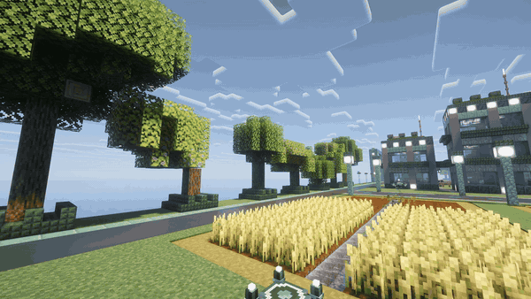

A drone is put together in the **Drone Assembler** from three kinds of parts:

- a **frame** in three tiers (Basic, Advanced, Elite) that sets its battery, speed and room for
  modules and addons; or the half-size **Mini Frame**, four of which share a **Builder Swarm Dock**;
- **function modules**, which decide its job and hang their tool under it:
  **Harvester** (crops), **Quarry** (digs a whole area down to bedrock), **Transport** (from one
  storage to another, of any mod), **Planter**, **Logger** (fells whole trees and replants),
  **Rancher** (shears and milks), **Fertilizer**, **Fisher** (vanilla fishing loot, treasure
  included), **Breeder**, **Taxi** (carries you, hanging from its hook), **Builder**, **Guard**
  (hunts hostile mobs with a laser), **Bomb** (Mini Drones only), **Sponge** (sucks up any liquid
  from an area) and **Tank** (keeps that liquid, and carries it between tanks with a Transport Module);
- **addons**: Speed, Stack, Battery, Fortune, Silk Touch and Anchor.

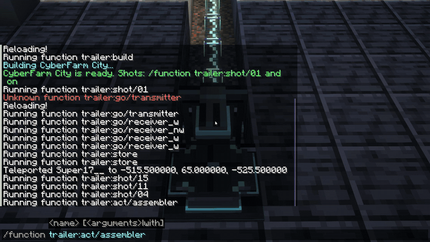

Every drone lives on a **Drone Dock**, which charges it and stores what it brings back. The
**Survey Tool** reads what the drone on the dock does and asks for what it needs: a work area, a
transport route or a taxi destination. The dock's **Area** button sends mini drones to light up what is
set, a **Dock Tank** against it stores liquids, and its item filter decides what it keeps. There is no
programming: an area and a dock are all a drone needs.

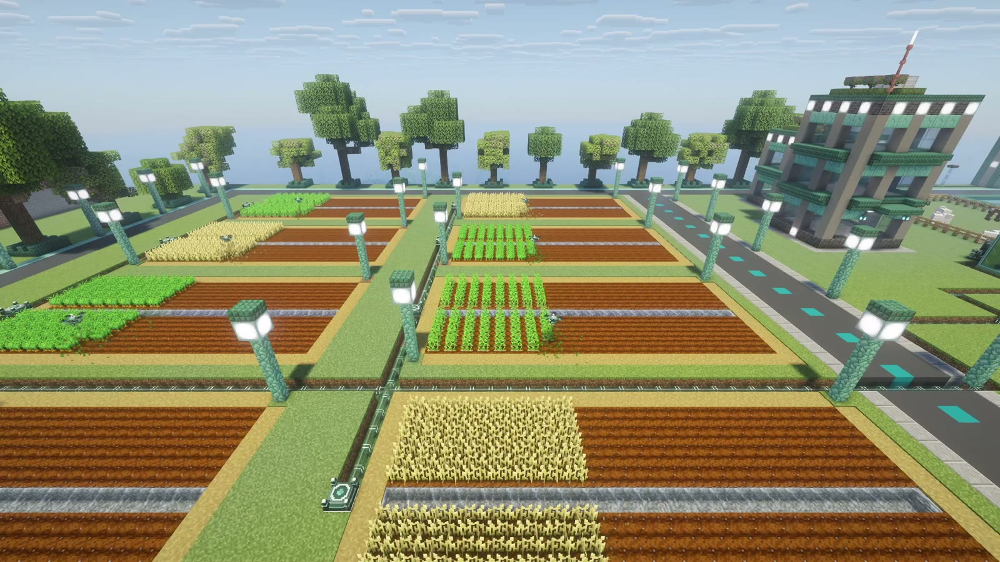

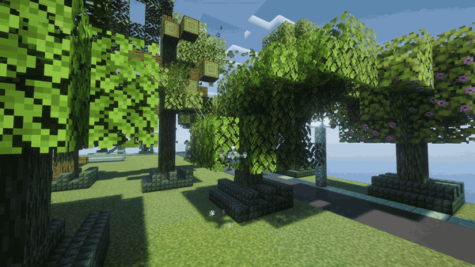

**Building with drones.** The **Multiblock Projector** shows any CyberFarm multiblock, or a
schematic, as ghost blocks. Lock it in place, link it to a dock, and its Builder drones raise it
layer by layer with the blocks you put in the dock or in chests beside it, clearing the site
first. The tech village's buildings come with the mod, and any data pack can add more schematics.

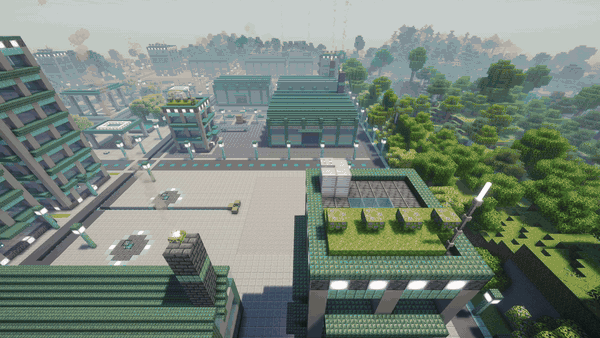

**The tech village.** A rare outpost in the Overworld hides the **Drone Mechanist**, a villager
who takes **supply contracts** at his **Supply Terminal** and offers to build a town with you. Fill
his contracts to raise the village through ten levels; each one hands you **Blueprint Discs** for
its seven buildings (Drone Workshop, Residence, Power Station, Hydroponic Farm, Market Hall, Outpost
and Watch Tower), in three tiers each, and every building does real work.

**Defending it.** **Laser Turrets** shoot the hostile mobs they see, a **Guard** drone hunts them
over its work area and a Mini Drone with the **Bomb** module dives at them.

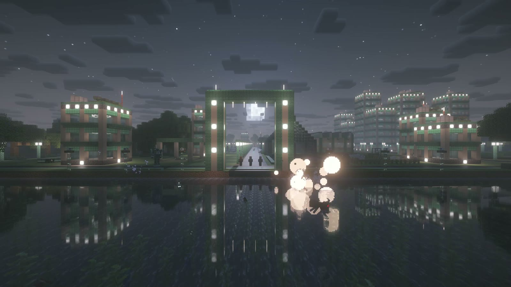

**Watching your base.** The **Hologram Table** projects the land around it in relief, with your
docks as pillars of light, your drones moving live with their trails, players as arrows and hostile
mobs as red dots. Right-click it to zoom between 16, 24 and 32 blocks. Tables side by side merge into
a 2x2 or 3x3 that reaches 48 or 64 blocks and writes each drone's name. Look at a machine, a tank or a
drone for a panel over it with what it is doing.

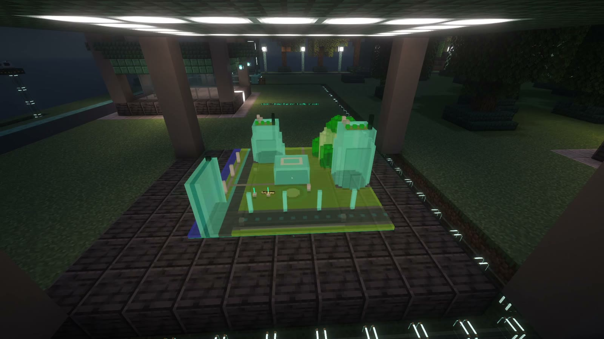

## Machines

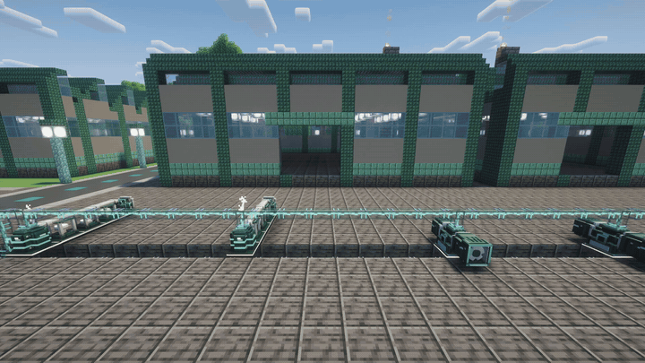

Most machines are small multiblocks: place the machine, add the **Cyber Frames** it asks for around it,
and it opens up into its working shape, with a light strip along its base that comes on while it works.
Break a frame and it closes again. Ten of them take **Speed**, **Efficiency** and **Battery** addons in
the slots beside their screen.

## Materials and progression

| Tier | Materials | Made in | Unlocks |
| --- | --- | --- | --- |
| **1** | Aluminum, Basic Circuits | Electrolyzer, crafting table, Fabricator | First frames, modules, docks and machines |
| **2** | Carbon Fiber, Advanced Circuits | Pyrolysis Oven (methane), Fabricator (acid) | Advanced frames and the mid-game machines |
| **3** | Elite Circuits | Fabricator (acid and uranium) | Elite frames, the reactor, the turbine and the mech |

Bauxite is found in the Overworld; each tier needs the power and chemistry of the one before it.

## Power

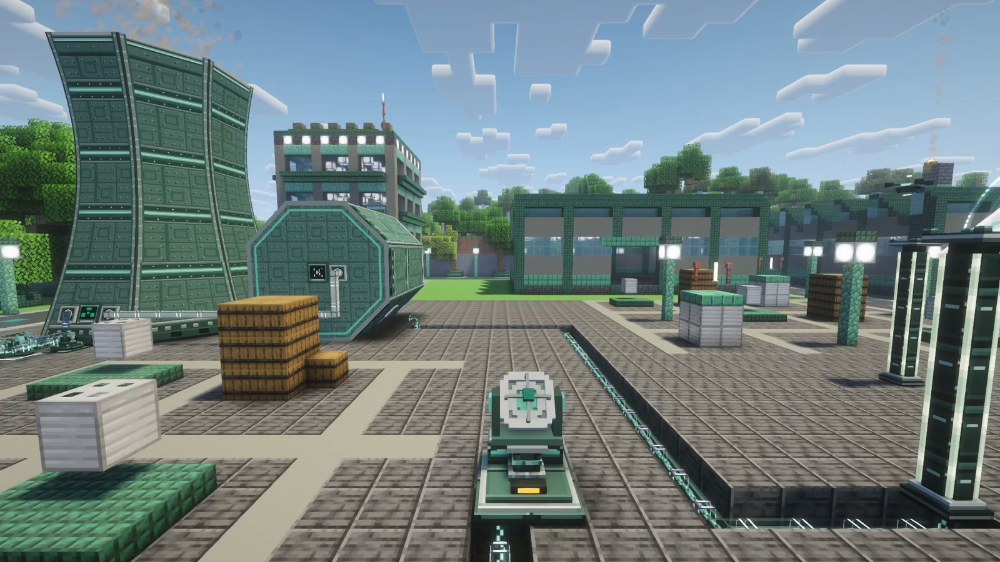

Power is **FE**, so CyberFarm machines work with the generators, cables and batteries of other mods.

1. **Combustion Generator**: burns furnace fuel.
2. **Gas**: the **Biomass Press** turns organic waste into Biomass, the **Bio-Digester** turns
   Biomass into biogas, the **Methane Extractor** (a 3x3x4 acid chamber you lead mobs into) collects
   methane, and the **Gas Turbine** burns both.
3. **Steam Engine**: a boiler that assembles with four Cyber Frames into a five-block engine, its
   pistons pumping and its flywheel spinning.
4. **Nuclear**: uranium, **Fuel Rods** and a **Fission Reactor** shaped like a real cooling tower in
   three sizes. Its heat boils water into steam for a multiblock **Steam Turbine** with a spinning
   rotor. Push it too hard and it melts down.

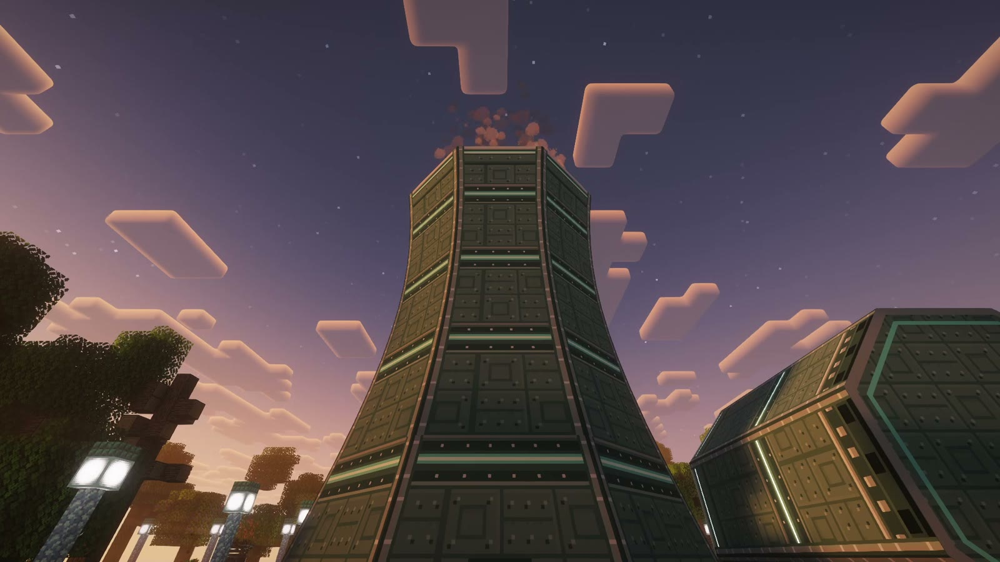

The nuclear tier brings real risks and the tools to handle them: **Coolant** and **Cryo Coolant**,
radioactive waste treated in the **Waste Reprocessor**, chunk radiation and Radiation Sickness, the
**Hazmat Suit** and the **Geiger Counter**.

**Storing it.** The **Resonance Core** is a buildable battery: a floating crystal held steady by
**Stabilizer Pylons**, growing with a shell of **Resonance Cells** through four tiers, up to 2 billion
FE. Energy goes in and out through the pylons.

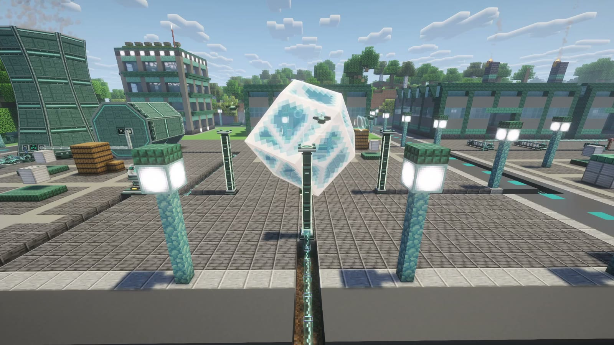

**Sending it.** A **Transmitter Dish** turns to its **Receiver Dishes** and sends them FE, up to four
of them, one after the other, losing a tenth on the way. Without a module it reaches 32 blocks at
2,000 FE/t; the **Range Modules** I, II and III take it to 128, 512 and 2,048 blocks, and the
**Infinity Range Module** anywhere, with no limit to the power. Networks are private or public, and a
receiver picks one in its screen.

## The Mech

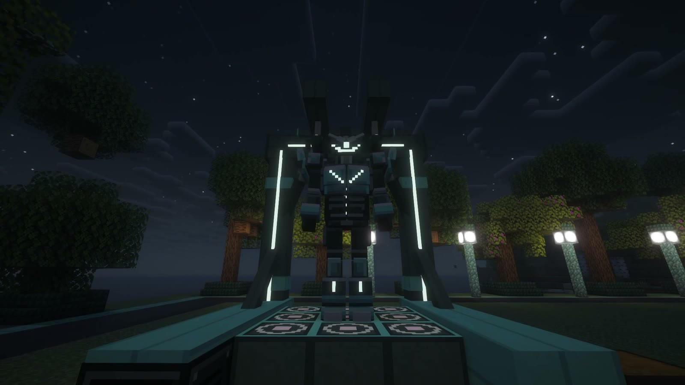

The end game: a pilotable mech about three and a half blocks tall. You step into the bay in its
trunk, the front closes around you like a flower, and you walk, jump and punch with it, with a
cockpit display instead of your hearts and hunger. A **Mech Hangar** unfolds it, parks it and fits
its four modules with a gantry arm: a **Jet** to fly, a **Drill** that digs 3x3, a glowing
**Blade** and **Armor** plating. Its heart, the **Mech Core**, is built around a Fusion Crystal
grown in the **Crystallizer** from reactor waste.

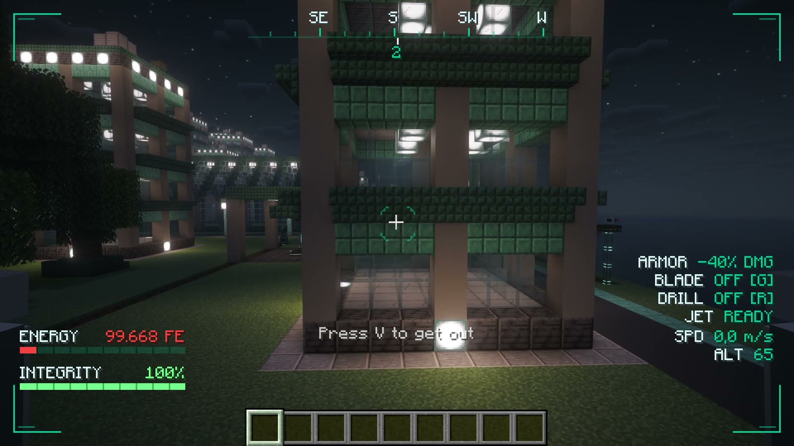

## Cables and tanks

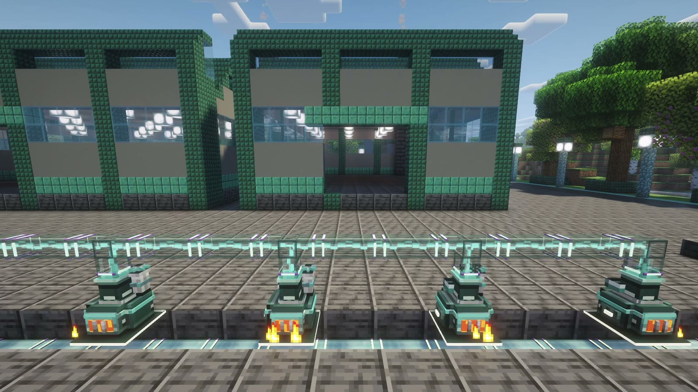

**Energy Conduits**, **Gas Pipes** and **Liquid Pipes**, each in three tiers, connect by themselves
to blocks of any mod, and their glass shows what flows through them. Right-click a cable's arm to pull
out of a battery, tank or machine. **Liquid Tanks** and **Gas Tanks** store 32 buckets each and merge
with the tanks next to them into one big vessel, its fluid seen through the glass. A **Water Pump**
standing on a water source gives an endless supply.

## Compatibility

- **JEI** and **REI**: recipe pages for every machine, drone assembly and info pages.
- Fluids, items and energy use the standard NeoForge capabilities and common `c:` tags (aluminum is
  `c:ingots/aluminum`), so pipes, tanks and machines of other mods work with CyberFarm's and the
  other way round.
- A **Muffler** silences machines, drones and mobs around it.

## Performance

Drones look for work every 2 seconds, not every tick. Profiled with [spark](https://spark.lucko.me)
on NeoForge 26.2, singleplayer, 20 Harvester + Planter drones working nonstop on 20 wheat fields:

| | Server, median | Server, worst tick | TPS |
| --- | --- | --- | --- |
| [No drones](https://spark.lucko.me/eRz5ZY97jN) | 4.8 ms/tick | 6.9 ms | 20 |
| [20 drones](https://spark.lucko.me/7DZMDMHpXD) | 5.2 ms/tick | 7.6 ms | 20 |

That is about 0.02 ms per drone. The [client](https://spark.lucko.me/QHCAbxG5Ik) stayed under
1 ms per tick with the 20 drones in view. Other modules and servers are not profiled yet: if you
see lag, a spark report in a [GitHub issue](https://github.com/Gianni1707/cyberfarm/issues) helps
a lot.

## Requirements

| | 26.2 | 26.1.2 | 1.20.1 |
| --- | --- | --- | --- |
| Loader | NeoForge 26.2.0.93 or newer | NeoForge 26.1.2.97 or newer | Forge 47.1.3 or newer, or NeoForge 1.20.1 |
| Java | 25 | 25 | 17 |
| In-game handbook (optional) | [GuideME](https://www.curseforge.com/minecraft/mc-mods/guideme) | [GuideME](https://www.curseforge.com/minecraft/mc-mods/guideme) | [Patchouli](https://www.curseforge.com/minecraft/mc-mods/patchouli) |
| Recipe pages (optional) | JEI or REI | JEI or REI | JEI or REI |
| Source branch | `master` | `mc/26.1.2` | `mc/1.20.1` |

## Installation

Download the jar for your Minecraft version from [CurseForge](https://www.curseforge.com/minecraft/mc-mods/cyberfarm)
or the [releases](https://github.com/Gianni1707/cyberfarm/releases) (`cyberfarm-<version>+mc<minecraft>.jar`)
and put it in the `mods` folder, plus the handbook mod for that version. It is needed on both the
server and the client.

## Building from source

Each Minecraft version is built from its own branch (see the table above).

```bash
./gradlew build
```

The jar ends up in `build/libs/`. `./gradlew runClient` starts a development client; set
`recipe_viewer=jei` or `rei` in `gradle.properties` to choose the recipe viewer loaded with it.
Textures and models are generated by `tools/texgen.py` and `tools/assetgen.py`, the schematics by
`tools/schemgen.py` and the drone's flight sound by `tools/soundgen.py`.

## Made with Claude

CyberFarm is made with the help of **Claude**, Anthropic's AI, through Claude Code: the code, the
models and textures, the sounds and the handbook were written together with it, while the ideas,
the design choices and every in-game test are mine.

## License

MIT.
